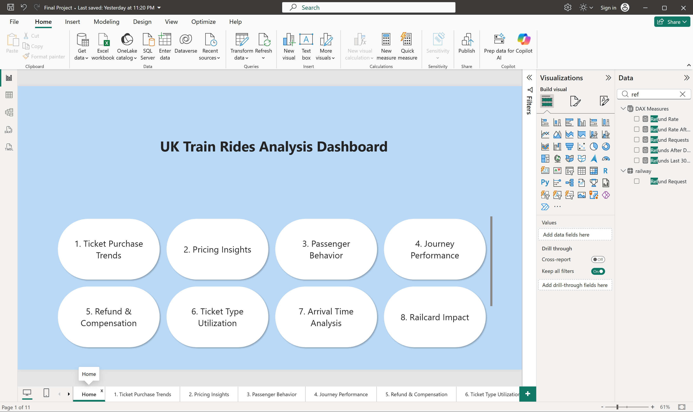
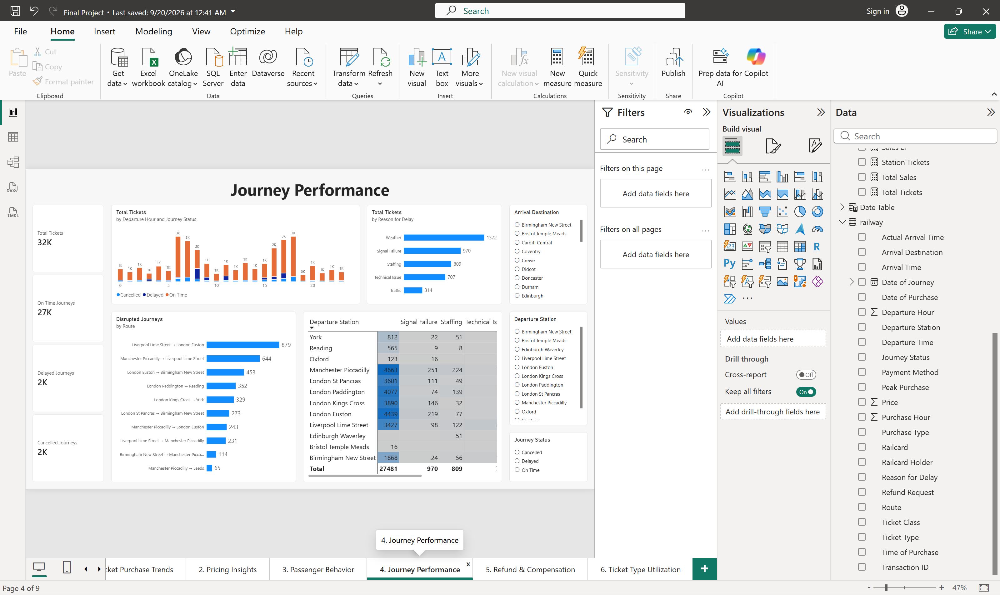
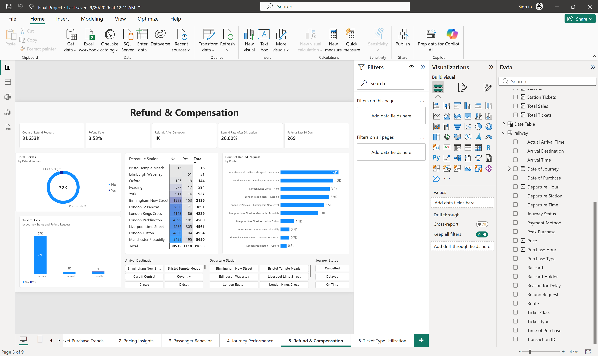
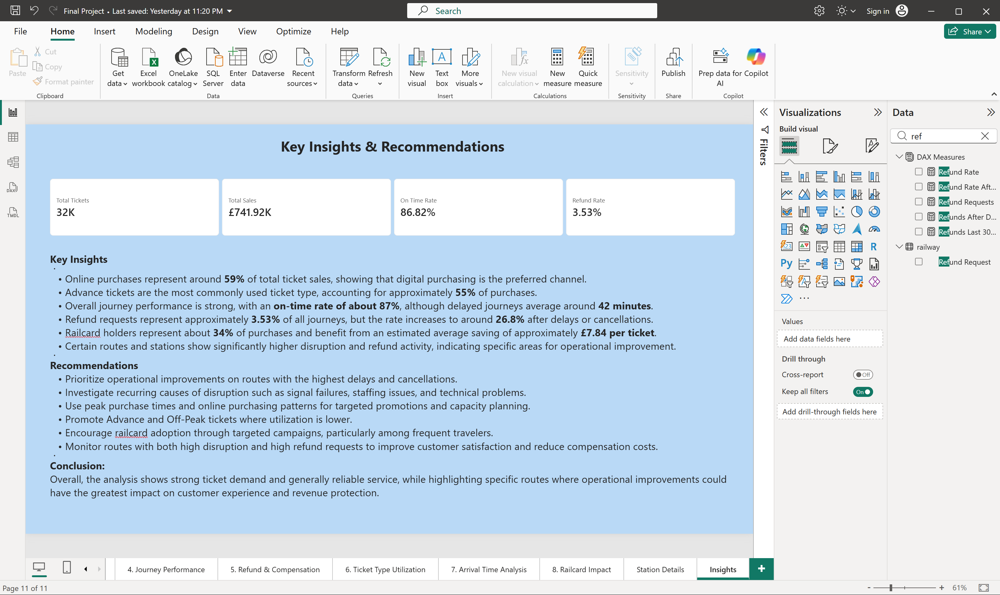

# UK Rail / Ticket BI – Final Project (Power BI)

Final Power BI project for the **Data Analysis & Business Intelligence Diploma** at **IMP**, focused on UK rail / ticket analytics.

## Overview

This report explores rail ticket purchase and journey data across multiple Power BI pages (names from the `.pbix` layout):

- Home
- 1. Ticket Purchase Trends
- 2. Pricing Insights
- 3. Passenger Behavior
- 4. Journey Performance
- 5. Refund & Compensation
- 6. Ticket Type Utilization
- 7. Arrival Time Analysis
- 8. Railcard Impact
- Station Details
- Insights

Included files:

- `Final_Project.pbix` — Power BI report
- `data/railway.csv` — source ticket/journey extract used for analysis
- `data/railway_data_dictionary.csv` — field descriptions
- `docs/screenshots/` — Power BI Desktop screenshots

## Screenshots

| Home | Journey Performance |
|---|---|
|  |  |

| Refund & Compensation | Insights |
|---|---|
|  |  |

Example visual titles from the report layout include: *Drill-down - Total Tickets*, *Drill-through - Average Ticket Price*, *Top 10 Routes for Advance Tickets*, *Average Delay by Arrival Destination*, *Ticket Type by Railcard Holder*, *Ticket Class by Railcard Holder*, *Purchase Type by Railcard Holder*.

## Key findings

Computed from `data/railway.csv` (**31,653** tickets) and aligned with the Insights / KPI cards in the report:

- **Total sales:** **£741,921** (report card ≈ **£741.92K**); average ticket price ≈ **£23.44**.
- **On-time rate:** **86.82%** (**27,481** On Time / **2,292** Delayed / **1,880** Cancelled).
- **Purchase channel:** Online **58.5%** vs Station **41.5%** (report text ≈ 59% online).
- **Ticket type:** Advance **55.5%**, Off-Peak **27.6%**, Anytime **16.9%**.
- **Refund rate:** **3.53%** overall (**1,118** Yes / **30,535** No). Among disrupted journeys (Delayed + Cancelled), refund requests rise to about **26.8%**; on-time journeys show **0%** refund requests in this extract.
- **Railcard holders:** about **33.9%** of tickets (**10,735** with Adult/Disabled/Senior). Average price for holders ≈ **£15.67** vs **£27.43** without (difference ≈ **£11.76** in this extract; the Insights page notes an average saving figure of about **£7.84** from the report’s own measure logic).
- **Ticket class:** Standard **28,595** vs First Class **3,058**.
- Top delay reasons in the Delayed subset include Weather, Technical Issue, and Signal Failure (values appear with mixed capitalisation in the CSV).

## Tools

- Microsoft Power BI Desktop

## How to open

1. Clone or download this repository.
2. Open `Final_Project.pbix` in **Power BI Desktop**.
3. If prompted to refresh, point the data source at `data/railway.csv` (or your original path) and refresh.

> To capture every page as an image, open the `.pbix` in Power BI Desktop and export/screenshot remaining pages into `docs/screenshots/`.

## Credit

**Data Analysis & Business Intelligence Diploma | IMP | Expected Dec 2026**
